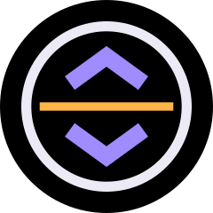

# OpenPuck logo

<p align="center"></p>

**The mark is Split Duel: one chevron per player, split by the amber seam.**
The ring is the puck and its round screen. Each chevron faces one player
across the table, the way the two-player layout does, and the seam between
them is the line that splits the screen.

It's built from a circle, two three-point polylines and one line, so the
firmware draws it natively with LVGL (`main/logo.c`) instead of storing a
bitmap, and it stays sharp from a 16 px favicon to the full 240×240 screen.

The device UI follows the same "Holotable" language: a black field, hairline
frames, one violet action color and amber reserved for one meaning. The full
spec is in [`holotable-restyle.md`](holotable-restyle.md).

## Files

| File | Use |
|---|---|
| `openpuck-lockup.svg` | Mark + wordmark, for dark backgrounds (README header in dark mode, installer) |
| `openpuck-lockup-light.svg` | Mark + wordmark, for light backgrounds |
| `openpuck-lockup-tagline.svg` / `-light.svg` | Lockup with "LIFE COUNTER FIRMWARE" |
| `openpuck-mark.svg` | Mark alone, dark backgrounds |
| `openpuck-mark-light.svg` | Mark alone, light backgrounds |
| `openpuck-mark-mono.svg` | One color, follows `currentColor` (stickers, laser-etching, 1-bit) |
| `openpuck-avatar.svg` / `.png` | Rounded tile, 512 px: GitHub org/repo avatar, app icon |
| `openpuck-favicon.svg` | 16 px favicon (the small-size row, no seam) |
| `openpuck-social.png` | 1280×640 GitHub social preview (Settings → General → Social preview) |
| `openpuck-device.svg` / `-240.png` | Reference for the device splash at 1:1 |

Everything here, PNGs included, is regenerated by `tools/gen_logo.py`
(Python + fontTools, and CairoSVG for the PNGs):

```sh
python tools/gen_logo.py docs/brand fonts/AtkinsonHyperlegibleNext-Bold.ttf
```

The wordmark is converted to outlines, so no font is needed to display the
files. `installer/img/` holds copies of the avatar, favicon and lockups.

## Colors

The mark:

| Variant | Ring | Chevrons | Seam | Background |
|---|---|---|---|---|
| Dark (default) | `#ECEBF5` Bone | `#A08CFF` Violet | `#FFB547` Amber | `#0F0F17` or transparent |
| Light | `#0F0F17` | `#6247E0` | `#D98A00` | `#F6F5FB` or white |
| Mono | `currentColor` | `currentColor` | `currentColor` | none |

The device palette (`main/ui_theme.h`). LVGL draws in RGB565, so tints are
pre-blended solid colors over black:

| Token | Hex | Use |
|---|---|---|
| `BG` | `#000000` | Screen background |
| `PANEL` | `#171724` | Neutral button fill, unselected tab, list row fill |
| `LINE` | `#262636` | Row borders |
| `LINE_STRONG` | `#3A3A52` | Menu dividers, unselected tab and preset borders |
| `BONE` | `#ECEBF5` | Logo ring, menu text, primary text |
| `MUTED` | `#9A98B3` | Secondary text: "min", ranges, version label |
| `VIOLET` | `#A08CFF` | Buttons, selected state, pause icon, title underline |
| `VIOLET_INK` | `#0E0820` | Text on violet buttons |
| `VIOLET_LINE` | `#605499` | Violet at 60%: timer pill and center-button outlines |
| `VIOLET_PRESSED` | `#13111F` | Violet at 12%: menu pressed band |
| `AMBER` | `#FFB547` | Two-player seam, running change |
| `OVERTIME` | `#FF7A59` | Overtime timer text and pill outline |
| `P1_HISTORY` | `#4FC3F7` | P1 label in History on the default background |
| `P2_HISTORY` | `#A08CFF` | P2 label in History on the default background |

Player colors (presets and custom) stay the user's; a colored background draws
the chrome in that player's text color instead.

## Geometry

Defined on a 64×64 grid, center (32, 32):

| Part | Geometry | Stroke |
|---|---|---|
| Ring | circle, center-line radius 24 | 3 |
| Top chevron | (21, 25) → (32, 17) → (43, 25), miter join, butt caps | 5 |
| Bottom chevron | (21, 39) → (32, 47) → (43, 39), the mirror | 5 |
| Seam | (12, 32) → (52, 32), butt caps, inside the ring | 2.5 |

Scale by `diameter / (48 + ring stroke)` so the ring's outer edge is the
requested diameter (51 at the large row). On the device the splash uses an
outer diameter of 192.

### Small sizes

Strokes thicken as the mark shrinks (64-grid units):

| Rendered size | Ring | Chevrons | Seam |
|---|---|---|---|
| ≥ 64 px (splash) | 3 | 5 | 2.5, x 12→52 |
| 48 px (menu center, lockup, avatar) | 4 | 6 | 3.5, x 13→51 |
| 32 px | 5 | 7 | 4.5, x 14→50 |
| 16 px (favicon) | 7 | 9, points (20,24) (32,16) (44,24) and mirror | none |

`logo_create()` picks the row from the diameter (≥ 64, ≥ 40, ≥ 24, smaller).

## Wordmark

- **OPENPUCK**, all caps, Atkinson Hyperlegible Next Bold (the face of the
  life totals on the device), tracking +6 %. "OPEN" in Bone, "PUCK" in Violet
  (light: `#0F0F17` and `#6247E0`).
- Optional tagline **LIFE COUNTER FIRMWARE**, same face, 0.3× the wordmark
  size, tracking 0.22 em, `#9A98B3` (light: `#4D4B66`).
- The mark sits left of the text, 1.75× the font size tall, half the font size
  away, vertically centered on the text.
- The mark is not an "O": don't use it in place of a letter.

## App icon

Rounded square filled `#0F0F17`, corner radius 21 % of the side, a 2 px inner
stroke `#3A345D` (violet at 30 %), the mark at 70 % of the side using the
48 px stroke row.

## On the device

```c
#include "logo.h"
lv_obj_center(logo_create(lv_screen_active(), 192));   // full-screen splash
```

The menu center uses 56. The returned object isn't clickable, so it never
swallows taps meant for the counter.

## Don'ts

- Don't let the seam touch or cross the ring.
- Don't use amber for anything but the seam (in the logo) and the seam and
  running change (on the device).
- Don't round the chevrons' joints or caps, or add a second accent.
- Don't put the mark on a busy background or a light gray where the ring
  loses contrast; use the light variants on white.
- Don't use the MetalFab Tokens or Life Puck names in the logo.
