# OpenPuck user guide

This guide shows how to use your Life Puck running OpenPuck. It covers every
screen and every setting. Not installed yet? Start with the
[install guide](install.md).

**Contents**

- [Turning it on and off](#turning-it-on-and-off)
- [Battery and charging](#battery-and-charging)
- [Counting with one player](#counting-with-one-player)
- [Counting with two players](#counting-with-two-players)
- [The menu](#the-menu)
- [The power button](#the-power-button)
- [The timer](#the-timer)
- [History](#history)
- [Settings](#settings)
- [What is saved](#what-is-saved)
- [Tips](#tips)

## Turning it on and off

- **On:** press the power button. The OpenPuck logo shows for a moment, then
  the counter appears.
- **Off:** press and hold the power button for 2 seconds. The screen says
  "Release to power off". Let go and the puck switches off.
- **Auto-off:** the puck also switches itself off when it has been left alone
  for a while. See [Auto-off](#auto-off).

A quick tap on the power button does not turn the puck off. It is used for
going back and for the timer (see [The power button](#the-power-button)).

## Battery and charging

Plug in a USB-C cable to charge.

- The battery icon shows how full the battery is. It turns **red** when the
  battery is low (10% or less).
- While the puck is **charging**, the icon turns **green**.
- If you picked a colored background (see [Colors](#colors)), green could be
  hard to see. In a one player game on a colored background, the icon uses your
  text color and gets a small **lightning bolt** while charging instead.
- You can show only the icon, the icon with a percentage, or nothing. See
  [Battery](#battery) in Settings.

## Counting with one player

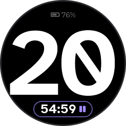

A new game starts at 0.

- **Tap the top half** of the screen to add 1.
- **Tap the bottom half** to subtract 1.
- **Press and hold** the top or bottom half to change by 5. Keep holding and it
  keeps going, 5 at a time.
- The number never goes below 0 or above 99.

**Running change.** When you change the number, a small "+2" or "-3" appears
at the top for about a second and a half. It adds up your quick taps, so you
can see how much you gained or lost in one go. When it goes away, the next tap
starts a new count. (While it shows, it takes the place of the battery icon.)
On the default black background it shows in **amber**, for adds and subtracts
alike; on a colored background it uses your text color.

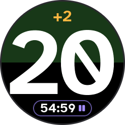

**Tap flash.** Each tap briefly tints the half you touched: green for add, red
for subtract. On a colored background the flash uses your text color instead.

**Underline.** A puck on a table can be read from either side, and some numbers
look like a different number when turned upside down. A 6 looks like a 9. When
that could happen, a short line appears under the number. The line is always
below the number from the player's point of view, so it shows which way is up.
It shows for 6 and 9, and also for numbers such as 66, 68, 86, 89 and 98. It
does not show for numbers that read the same either way up (such as 0, 8, 69
and 88) or for numbers that cannot be mistaken for another one (such as 7 or
25).

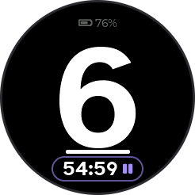

**Timer.** When the timer is on, it sits at the bottom of the screen. See
[The timer](#the-timer).

## Counting with two players

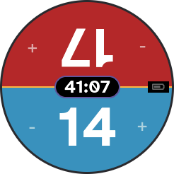

In a two player game the screen is split into two halves, one for each player.

- **Player 1** has the **bottom** half. It reads the normal way up.
- **Player 2** has the **top** half. It is turned upside down, so it reads
  correctly for the person sitting on the opposite side of the table.
- Each half has a small **-** and **+** on its sides. **Left and right are
  from that player's own point of view.** For you at the bottom, tap the left
  side of your half to subtract and the right side to add. Player 2 sits across
  from you, so their left and right are the opposite of yours.

**Sitting side by side?** Set **P2 faces** to **same way** in the
[New game](#new-game) menu. Player 2's half then reads the right way up like
yours, and both halves subtract on the left and add on the right:

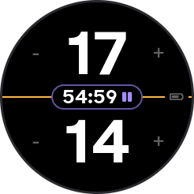
- Tap for 1. Press and hold for 5, and keep holding to keep going.
- Each player has their own number, running change, tap flash and underline.
  Each number stays between 0 and 99.
- The **timer** and the **battery** sit on the thin amber line between the
  two halves.
  When the timer is showing, the battery shows its icon only, even if you
  chose "Icon + %".

Player colors can be set separately for each player. See [Colors](#colors).

## The menu

**Press and hold the center of the screen** to open the menu. (The center is
the middle circle, about the size of a coin.) The menu is a ring with four
sections, one in each corner of the screen:

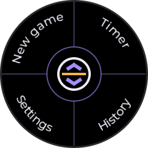

| Section | Where | What it does |
|---|---|---|
| **New game** | top left | Start over, and choose which way player 2 faces. |
| **Timer** | top right | Control the countdown timer and set its length. |
| **Settings** | bottom left | Colors, brightness, auto-off and the battery display. |
| **History** | bottom right | See every change since the game started. |

To pick one, touch it and lift your finger while still inside the same
section. If you slide out of the section before you let go, nothing happens.
**Tap the logo in the center to close the menu.**

New game, Timer and Settings open a ring of their own. Some sections show a
second, smaller line with the current value, such as "60%" under Brightness.
In these rings the center says **Back** and takes you to the main menu.

### New game

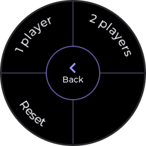

| Choice | Where | What it does |
|---|---|---|
| **Reset** | top left | Start over with the same number of players ("keeps 1P" or "keeps 2P"). |
| **P2 faces** | top right | Switch between **across** and **same way**. See below. |
| **1 player** | bottom left | Start a one player game. |
| **2 players** | bottom right | Start a two player game. |

The game you are playing now is marked "playing now". Every new game sets all
numbers back to 0, clears the history and resets the timer, and the menu
closes.

**P2 faces** decides how player 2's half of the screen is turned:

- **across** (the default): upside down, for a player sitting opposite you.
- **same way**: the right way up, for a player sitting next to you.

Tapping it switches right away without starting a new game, and the menu stays
open. You can set it during a one player game too, so it is ready for the next
two player game. It is saved with your settings.

### Timer menu

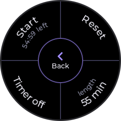

| Choice | Where | What it does |
|---|---|---|
| **Start** / **Pause** | top left | Starts the timer, or pauses it while it runs. The small line shows the time left. |
| **Reset** | top right | Puts the timer back to its full length. |
| **Timer off** | bottom left | Turns the timer off (and resets it). |
| **(length) min** | bottom right | Opens the page where you set the length. |

When the timer is off, the ring only shows **Timer on**, in the top left, with
the length it will start with:

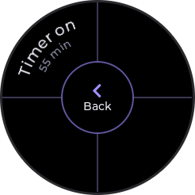

Start, Pause, Reset and Timer on/off close the menu.

**Setting the length.** Tap the length (for example "55 min"). A page opens
with the number in the middle and a round **-** and **+** button on each side.
Tap a button to change the length by 5 minutes. Hold it to keep going. The
length can be anywhere from 5 to 180 minutes. The ring around the edge fills up
as the length grows, and a button is dimmed when you reach that end. **Tap the
number or the title** (it has a small **<** in front of it), or press the power
button, to go back to the counter. This is the
only place to set the length.

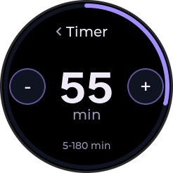

## The power button

The power button does different things depending on how long you press it.

- **Short press:**
  - In a menu, History, the color screens or any page with **-** and **+**:
    **go back** one step. From the main menu it closes the menu. The
    brightness and auto-off pages go back to Settings; the timer length page
    goes back to the counter.
  - On the counter: **start or pause the timer.** This only works when the
    timer is on.
- **Long press (2 seconds):** turns the puck off.

## The timer

The timer counts **down** from the length you set (55 minutes at first). It is
a small pill-shaped display at the bottom of the screen in a one player game,
and on the line in the middle in a two player game.

- It shows minutes and seconds, such as `54:59`.
- A small **pause** symbol shows next to the time when the timer is not
  running (before you start it, or while it is paused).
- Start and pause it from the menu, or with a short press of the power button.
- When time runs out, it keeps going into **overtime**. It shows a plus sign
  and counts up, such as `+0:42`, in **orange-red**, with an outline to match.
  (In a one player game on a colored background, the time stays in your text
  color so it is easy to read, but the plus sign still shows.)

  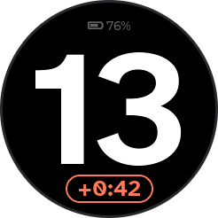
- **Auto-off is held back while the timer runs**, so the puck does not switch
  off in the middle of a game. When you pause the timer, the idle countdown
  starts again.
- If you turn the puck off, the timer comes back **paused** with the time it
  had when it was saved. It does not count while the puck is off.
- If you change the timer length, the remaining time changes with it.
- A new game resets the timer. Turn the timer off in the Timer menu if you do
  not want it on screen.

## History

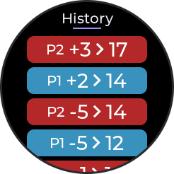

Open it from the menu (bottom right). It lists the changes made since the game
started, **newest first**. Each row shows the change and the new total, such as
"+5 > 25". Scroll with your finger to see older ones. The puck keeps the most
recent 100.

- Quick taps on the same player (each within about a second and a half of the
  last) are **combined** into one row. So five quick taps of +1 show as one
  "+5" row. If they cancel each other out, the row disappears.
- In a two player game, each row starts with **P1** or **P2**.
- Rows use each player's colors. On the default black background, rows are
  dark panels with a solid tag for the player (**P1 sky blue**, **P2
  yellow**), adds in green and subtracts in red. On a colored background, the
  row uses that player's own colors.

  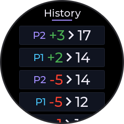
- With no changes, it says "No changes yet".
- **Tap anywhere** (or tap Done at the bottom of the list) to close it.
  Scrolling does not close it. The power button also closes it.

Starting a new game clears the history.

## Settings

Open Settings from the menu (bottom left). It is a ring like the others.
Changes apply right away and are saved. The center says **Back** and shows the
firmware version (for example "v0.3.0"), which is useful when reporting a
problem.

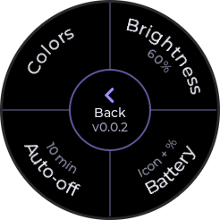

| Choice | Where | Small line | What it does |
|---|---|---|---|
| **Colors** | top left | "P1 / P2" in a two player game | Opens the colors. |
| **Brightness** | top right | for example "60%" | Opens the brightness page. |
| **Auto-off** | bottom left | for example "10 min", or "Off" | Opens the auto-off page. |
| **Battery** | bottom right | "Off", "Icon" or "Icon + %" | Switches to the next choice. |

### Colors

Pick the colors of your counter. Each player has their own.

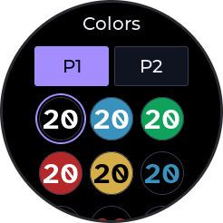

Ten round **swatches** sit around the edge, each showing "20" in its colors:

- **Default:** white on black.
- **Blue, Green, Red, Yellow:** a colored background with a white number
  (black on Yellow).
- **Blue text, Green text, Red text, Yellow text:** a black background with a
  colored number.
- **Custom** (the rainbow one with a **+**): make your own. See below.

The colors you are using now have a violet ring around their swatch. The
circle in the middle is a preview.

**One player game:** tapping a swatch applies it and takes you straight back
to the counter.

**Two player game:** the preview is split like the counter, player 2 on top
and player 1 below, with the amber line between them. **Tap a half of the
preview** to choose whose colors you are changing; that half gets a violet
outline and a small "P1" or "P2". Player 1 is chosen when the ring opens.
Tapping a swatch applies it to that player and the ring stays open, so you can
set the other player too.

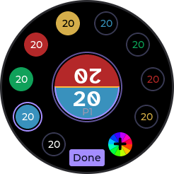

Tap **Done** at the bottom (or press the power button) to go back to Settings.

**Custom colors.** Tap the **Custom** swatch. A ring with two halves opens for
the chosen player: **Background** on top and **Text** at the bottom, each with
a dot in its current color. Tap the center (or press the power button) to go
back to the swatches.

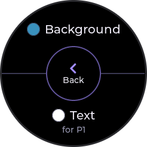

Tap a half to open the color picker for that color:

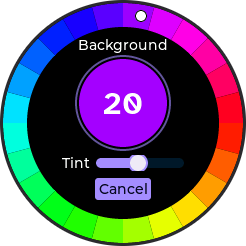

1. Slide your finger around the colored **ring** at the edge to pick the hue
   (the basic color).
2. Use the **Tint** slider in the middle to make it darker or lighter. All the
   way left is black, all the way right is white, and the middle is the pure
   color. If the color you start from is black, white or gray, the
   slider starts in the middle so the ring shows its colors right away.
3. The circle in the middle shows a preview. **Tap the circle to save.** Tap
   **Cancel** to leave without saving. The power button also cancels. Either
   way you are back on the Custom ring.

When you save a custom background, the puck picks black or white text for you,
whichever is easier to read. You can then change the text color with **Text**.

### Brightness

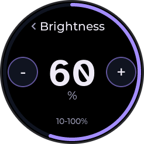

Use **-** and **+** to change the screen brightness from 10% to 100%, in steps
of 10%. The default is 60%. The screen changes as you tap. **Tap the number or
the title** (or press the power button) to go back to Settings.

### Auto-off

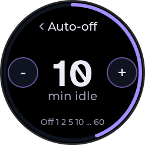

How long the puck waits, after it has been left alone, before it turns itself
off. "Left alone" means no touch and no press of the power button. Any touch or
press starts the countdown over. The puck stays on while the timer is running.

Use **-** and **+** to step through **Off, 1, 2, 5, 10, 15, 20, 30, 45 and 60
minutes**. The default is 10. **Off** keeps the puck on until you turn it off
yourself. The choices go round in a loop: **+** at 60 goes to Off, and **-** at
Off goes to 60.

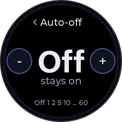

**Tap the number or the title** (or press the power button) to go back to
Settings.

### Battery

Tap **Battery** to switch to the next choice. The menu stays open and the
small line shows the new choice:

- **Off:** no battery indicator.
- **Icon:** the battery symbol only. This is the default.
- **Icon + %:** the symbol and the percentage.

In a two player game, the percentage is left out while the timer is showing,
so everything fits on the middle line.

## What is saved

The puck remembers these things when it is turned off and back on:

- the numbers, and whether it is a one or two player game,
- the history,
- the timer (it comes back paused),
- all of your settings: colors, brightness, battery display, timer length,
  timer on or off, auto-off, and which way player 2 faces.

Changes are saved a couple of seconds after you stop tapping, and again when
the puck turns itself off. If power is lost right after a tap, that last tap
may not be saved.

## Tips

- Not sure where you are? Tap the power button briefly to go back.
- To change a number fast, press and hold: it adds or subtracts 5 at a time.
- To open the menu, hold the **center**. Holding the top or bottom changes the
  number instead.
- Give the two players different colors so everyone can tell the halves apart
  at a glance.
- A lower brightness is easier on the battery.
- Something not working? See [troubleshooting](troubleshooting.md).
